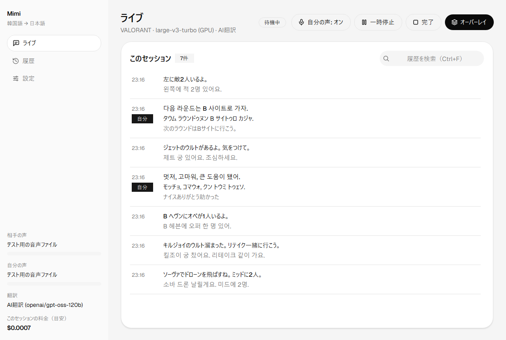
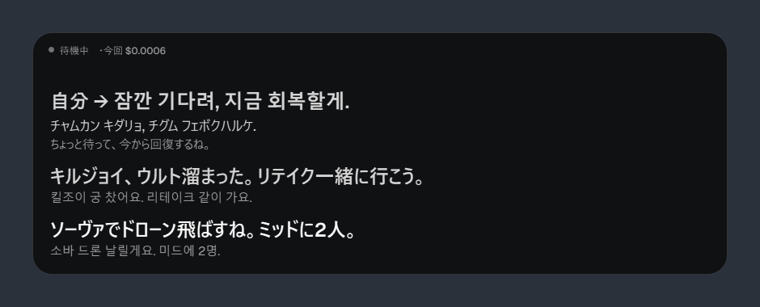
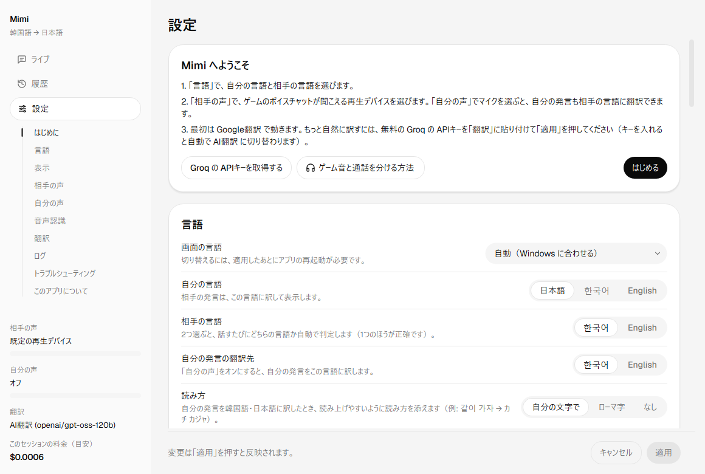

# Mimi

**ゲームのボイスチャットを、リアルタイムで翻訳して字幕に。**
Real-time subtitles and translation for your game's voice chat. / 게임 보이스 채팅을 실시간으로 번역해서 자막으로.

[日本語](#日本語) · [English](#english) · [한국어](#한국어)

---

## 日本語

Mimi は、ゲームのボイスチャットで話された言葉を聞き取って翻訳し、字幕として表示する Windows アプリです。
自分の発言も相手の言語に訳し、読み方（カタカナなど）と一緒に表示できるので、そのまま読み上げて返事ができます。

- 🎧 **相手の声を翻訳** — ボイスチャットの音声を聞き取り、自分の言語で表示（日本語・韓国語・英語）
- 🎙️ **自分の声も翻訳** — 自分の発言を相手の言語に訳して、読み方と一緒に表示（例: 같이 가자 → カチ カジャ）
- ⚡ **リアルタイム** — 話している最中から文字起こしを表示。話し終わってから約1秒で翻訳
- 🪟 **2つの表示** — 翻訳履歴をさかのぼれるウィンドウと、ゲーム画面に重ねるオーバーレイ
- 🔒 **音声は PC の外に出ない** — 音声認識は PC の中（GPU）で行い、翻訳する文だけを翻訳サービスに送ります

### ダウンロード

[Releases](../../releases/latest) から `Mimi-<版>-win64.zip` をダウンロードしてください。

### 必要なもの

- Windows 10 / 11（64ビット）
- NVIDIA の GPU（GeForce GTX 16 シリーズ以降を推奨）と最新のドライバー
- 空き容量 約3GB（初回起動時に音声認識モデル 約1.6GB をダウンロードします）

### はじめかた

1. zip を展開して `Mimi.exe` を起動します。「Windows によって PC が保護されました」と出たら「詳細情報」→「実行」を押してください。
2. 初回は設定画面が開きます。言語、相手の声が聞こえるデバイス、マイクを選んで「はじめる」を押します。
3. 最初は Google翻訳で動きます。もっと自然に訳すには、無料の Groq の APIキーを [console.groq.com/keys](https://console.groq.com/keys) で作って、設定の「翻訳」に貼り付けて「適用」を押してください。
4. ライブ画面の「開始」を押すと、聞き取りと翻訳が始まります。「完了」を押すとセッションが終わり、会話は「履歴」から見返せます。

### ヒント

- ボイスチャットだけを別の再生デバイス（仮想オーディオデバイスなど）に出すと、ゲーム音を拾わずに済み、聞き取りの精度が上がります。やり方は、設定の「相手の声」→「やり方を見る」にあります（VB-CABLE・SteelSeries Sonar。どちらも無料）。
- オーバーレイをゲームの上に表示するには、ゲームの画面モードを「フルスクリーン」以外（ボーダーレス・ウィンドウ）にしてください。
- VALORANT 用の用語集（韓国語→日本語）が入っています。設定の「ゲームの用語集」で選べます。

### 困ったときは・お問い合わせ

- 設定の「トラブルシューティング」→「動作の診断」を押すと、GPU・音声認識・録音・翻訳が正しく動いているかを約5秒で確かめられます。録音のつなぎ直しや、設定を初期値に戻すこともできます。
- 不具合の報告や要望は、Discord（ユーザー名: **lonelylimits**）で受け付けています。診断の「結果をコピー」を押すと結果をそのまま貼り付けて送れるので、一緒に送ってもらえると助かります（APIキーは含まれません）。

### アンインストール

展開したフォルダと、`%APPDATA%\Mimi`（設定・ログ）、`%LOCALAPPDATA%\Mimi`（音声認識モデル）を削除してください。

---

## English

Mimi is a Windows app that listens to your game's voice chat, translates what people say, and shows it as subtitles.
It can also translate what *you* say into their language with a pronunciation guide, so you can read your reply out loud.

- 🎧 **Translate others** — voice chat is transcribed and shown in your language (Japanese, Korean, English)
- 🎙️ **Translate yourself** — your speech is translated into their language with a pronunciation guide
- ⚡ **Real time** — live transcription while people talk; translations about a second after they finish
- 🪟 **Two views** — a window with scrollable history, and an overlay on top of your game
- 🔒 **Your audio stays on your PC** — speech recognition runs locally on your GPU; only the text is sent to the translation service

### Download

Get `Mimi-<version>-win64.zip` from [Releases](../../releases/latest).

### Requirements

- Windows 10 / 11 (64-bit)
- An NVIDIA GPU (GeForce GTX 16 series or newer recommended) with an up-to-date driver
- About 3 GB of free space (the speech recognition model, about 1.6 GB, is downloaded on first launch)

### Getting started

1. Extract the zip and run `Mimi.exe`. If you see "Windows protected your PC", click "More info" → "Run anyway".
2. On first launch, Settings opens. Choose your languages, the device where you hear voice chat, and your microphone, then click "Get started".
3. Mimi starts with Google Translate. For more natural translations, create a free Groq API key at
   [console.groq.com/keys](https://console.groq.com/keys), paste it under "Translation" in Settings, and click "Apply".
4. Click "Start" on the Live page to begin listening and translating. Click "Finish" to end the session; you can review it in "History".

### Troubleshooting and contact

- In Settings, open "Troubleshooting" → "Diagnostics" to check the GPU, speech recognition, audio capture, and translation in about 5 seconds. You can also reconnect audio or reset your settings there.
- Report bugs or send requests on Discord (username: **lonelylimits**). Click "Copy results" in Diagnostics and paste them into your message — it helps a lot (API keys are not included).

To uninstall, delete the extracted folder, `%APPDATA%\Mimi` (settings and logs), and `%LOCALAPPDATA%\Mimi` (speech model).

---

## 한국어

Mimi는 게임 보이스 채팅에서 들리는 말을 알아듣고 번역해서 자막으로 보여 주는 Windows 앱입니다.
내가 한 말도 상대방 언어로 번역하고 읽는 법과 함께 보여 주므로, 그대로 읽어서 대답할 수 있습니다.

- 🎧 **상대방 말 번역** — 보이스 채팅 음성을 알아듣고 내 언어로 표시 (한국어·일본어·영어)
- 🎙️ **내 말도 번역** — 내가 한 말을 상대방 언어로 번역하고 읽는 법과 함께 표시
- ⚡ **실시간** — 말하는 도중부터 받아쓰기를 표시하고, 말이 끝나면 약 1초 만에 번역
- 🪟 **두 가지 화면** — 번역 기록을 거슬러 볼 수 있는 창과, 게임 화면 위에 겹쳐 보이는 오버레이
- 🔒 **음성은 PC 밖으로 나가지 않음** — 음성 인식은 PC(GPU)에서 처리하고, 번역할 문장만 번역 서비스로 보냅니다

### 다운로드

[Releases](../../releases/latest)에서 `Mimi-<버전>-win64.zip`을 받으세요.

### 필요한 것

- Windows 10 / 11 (64비트)
- NVIDIA GPU (GeForce GTX 16 시리즈 이상 권장)와 최신 드라이버
- 여유 공간 약 3GB (처음 실행할 때 음성 인식 모델 약 1.6GB를 다운로드합니다)

### 시작하기

1. zip을 압축 해제하고 `Mimi.exe`를 실행합니다. "Windows의 PC 보호" 화면이 나오면 "추가 정보" → "실행"을 누르세요.
2. 처음에는 설정 화면이 열립니다. 언어, 상대방 목소리가 들리는 장치, 마이크를 고르고 "시작하기"를 누르세요.
3. 처음에는 Google 번역으로 작동합니다. 더 자연스럽게 번역하려면 무료 Groq API 키를
   [console.groq.com/keys](https://console.groq.com/keys)에서 만들어 설정의 "번역"에 붙여 넣은 뒤 "적용"을 누르세요.
4. 라이브 화면에서 "시작"을 누르면 듣기와 번역이 시작됩니다. "완료"를 누르면 세션이 끝나고, 대화는 "기록"에서 다시 볼 수 있습니다.

### 문제가 있을 때·문의

- 설정의 '문제 해결' → '작동 진단'을 누르면 GPU·음성 인식·녹음·번역이 제대로 작동하는지 약 5초 만에 확인할 수 있습니다. 녹음 다시 연결이나 설정 초기화도 할 수 있습니다.
- 버그 신고나 요청은 Discord(사용자 이름: **lonelylimits**)로 받고 있습니다. 진단의 '결과 복사'를 누르면 결과를 그대로 붙여 넣어 보낼 수 있으니 함께 보내 주시면 도움이 됩니다 (API 키는 포함되지 않습니다).

삭제할 때는 압축을 푼 폴더와 `%APPDATA%\Mimi`(설정·로그), `%LOCALAPPDATA%\Mimi`(음성 인식 모델)를 지우세요.

---

Third-party licenses: [THIRD_PARTY_NOTICES.txt](THIRD_PARTY_NOTICES.txt)
